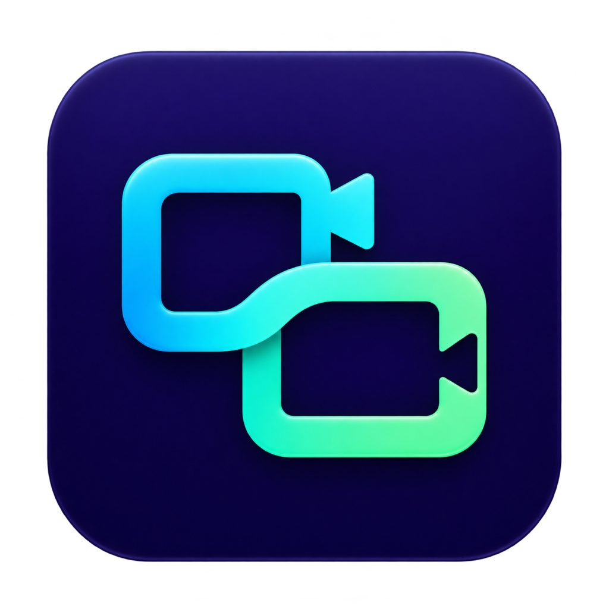

# FrameBridge

Play a PS5 through an HDMI capture card on an Apple Silicon Mac. FrameBridge targets 1080p60 by inserting a motion-estimated frame between pairs of 30 fps game frames. It also supports native capture playback and HDMI audio.

## Build and run

You need macOS 26 or later, Python 3, and Xcode or Command Line Tools with the macOS 26 SDK or later.

```sh
git clone https://github.com/7uvss/FrameBridge.git
cd FrameBridge
./build.sh
open ../FrameBridge.app
```

Connect the PS5 to the card’s HDMI input and the card to your Mac over USB. FrameBridge currently looks for devices named `USB3 Video` and `USB3 Digital Audio`. Allow camera access for video and microphone access for HDMI audio.

## Playback

Choose a mode from **Output (输出)** in the macOS menu bar.

- **Interpolation (补帧)** targets 30 fps games carried over a 60 Hz HDMI signal. FrameBridge takes every other capture slot and uses VideoToolbox and Metal to generate a midpoint. The playback buffer is 33 ms.
- **Native output (原生输出)** displays the latest capture frame directly. Use it for games that already render at 60 fps or when you want the lowest playback latency.

Both modes send game audio to the Mac’s current audio output.

## Benchmarks

On an idle Mac with the display awake, run the synthetic quality and frame-pacing tests. The runner exits if the preview is open.

```sh
python3 Benchmarks/run.py --out /tmp/framebridge.json
```

The report includes distinct frames presented, generated frames presented, and original-frame latency from capture callback to display. For an example with recorded gameplay, see the [0.11.6 replay results](Benchmarks/verified-0.11.6.json).
